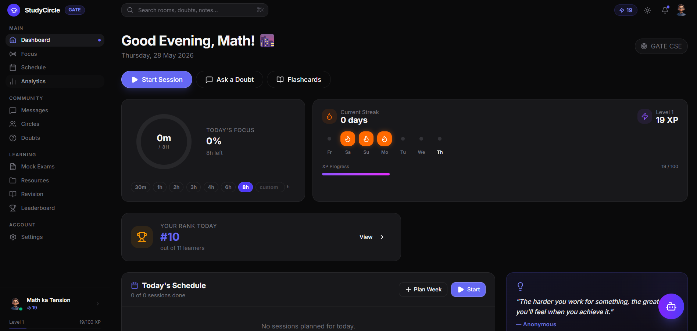

# StudyCircle

StudyCircle is a collaborative exam-prep platform built for students who want to study with accountability, structure, and momentum. The app combines daily focus tracking, live study rooms, mock exams, doubt solving, revision workflows, and community-driven learning in one place.

**Live app:** [studycircle-staging.onrender.com](https://studycircle-staging.onrender.com/)



## What the app does

- Tracks study streaks, focus time, and daily progress from the main dashboard
- Lets users join or create study circles and collaborate inside dedicated workspaces
- Supports live focus rooms for synchronized study sessions and community accountability
- Offers mock exams, exam-by-date planning, leaderboard tracking, and analytics
- Includes a public doubts feed for asking and answering questions across subjects
- Provides revision tools like flashcards, saved questions, mistake notebooks, and PYQ practice
- Includes achievements, direct messages, member profiles, and admin screens for managing cohorts

## Core features

- Study dashboard with streaks, timer, and daily summaries
- Focus rooms and study circles for real-time collaboration
- Mock exams and exam results with score breakdowns and leaderboards
- Doubts forum with Q&A flow and accepted answers
- Practice area with flashcards, saved questions, previous-year questions, and revision support
- Progress insights for analytics and exam preparation planning

## Tech stack

- Frontend: React, TypeScript, Vite, Wouter, TanStack Query
- UI: Tailwind CSS, Radix UI, Framer Motion
- Auth: Clerk
- API: Express/Node.js with generated API clients
- Data: Postgres + Drizzle ORM
- Real-time: LiveKit and Socket.IO
- Workspace setup: pnpm monorepo

## Run locally

Requirements: Node.js 20+ and pnpm.

```bash
pnpm install
pnpm --filter @workspace/studycircle dev
```

The frontend app runs from the `artifacts/studycircle` package, while the backend and shared libraries are configured as part of the workspace.

## Build and type-check

```bash
pnpm run build
pnpm run typecheck
```

## Project structure

```text
artifacts/
  studycircle/   # React + Vite frontend
  api-server/    # Express server and study APIs
lib/             # shared API client and schema packages
```
